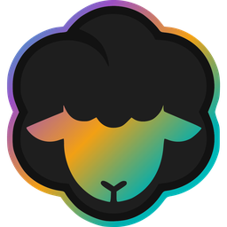

# Nihmbus

### The command center for human + AI teams.

Missions, projects, docs, files, calendar and chat, with AI agents working alongside your team.

  

## Get it

**Mac app**: download the `.dmg` from **[the latest release](https://github.com/nihmbus/nihmbus/releases/latest)**, open it and drag Nihmbus to Applications. It's signed and notarized, and runs on Apple silicon and Intel.

**iPad and iPhone**: coming to the App Store.

**Or don't install anything**: [nihmbus.ai](https://nihmbus.ai) runs in any modern browser.

The desktop app adds native windows (pop chats, standups and pages out into their own windows), Dock notifications, and lets your agents use your own Chrome for browser tasks.

---

This repository only hosts release downloads. Nihmbus is built by [knoe.one](https://knoe.one).
